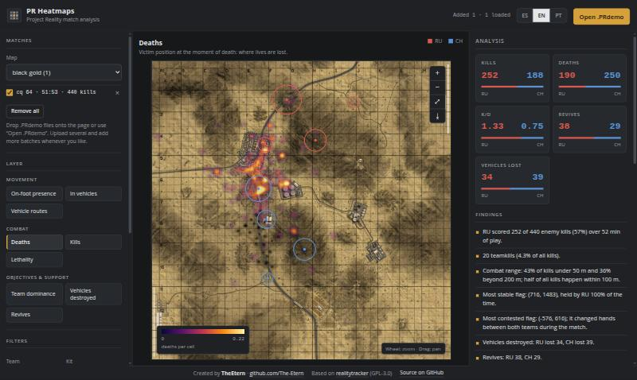

# PR Heatmaps

**English** · [Español](#español)

Heatmaps and automatic analysis for [Project Reality](https://www.realitymod.com/) matches, built from the `.PRdemo` recordings made by [realitytracker](https://github.com/yossizap/realitytracker).
It runs **entirely in your browser**: no server, no uploads. The files you open never leave your computer.



## Features

- 9 layers: on-foot presence, vehicle occupants, vehicle routes, deaths, kills, lethality (deaths per player-minute), team dominance, vehicles destroyed, revives.
- Filters by team, kit, vehicle type and match window, with a "sweep" animation over time.
- Upload as many `.PRdemo` files as you want, at once or in several batches. Matches of the same map are combined; duplicates are skipped.
- Automatic analysis: kill/death/revive comparison, combat distances, top weapons, flag control, tickets and plain-language findings.
- Zoom and pan (mouse wheel, drag, or two-finger pinch), hover tooltip with the in-game grid reference (e.g. `G6-5`), flag overlay.
- "Ignore after respawn" filter, to leave out the time players spend waiting at spawn points.
- Save the current map, layer and legend as a PNG ready to share.
- Spanish, English and Brazilian Portuguese.

## Use it

**Online:** open the GitHub Pages site of this repository (see *Publish* below), or

**Locally** (needs any static web server because browsers block ES modules on `file://`):

```bash
git clone https://github.com/The-Etern/pr-heatmaps.git
cd pr-heatmaps
python3 -m http.server 8765
```

Then open <http://localhost:8765> and drop your `.PRdemo` files onto the page (or use **Open .PRdemo**). The app starts empty: nothing is preloaded, and your files never leave your browser.
Dropping a PNG/JPG replaces the background image of the current map.

## Publish on GitHub Pages

Repository → **Settings → Pages → Deploy from a branch → `main` / root**. The site is static, so nothing else is needed.

## Tests and releases

```bash
npm test            # node --test: parser, grid references, filters (no dependencies)
npm run bump        # bump the ?v= cache-busting number before each release
```

The `?v=` number on every module import makes browsers fetch a consistent set of files after an update (GitHub Pages caches for a few minutes).

## Project layout

| File | Purpose |
|---|---|
| `src/parse.js` | `.PRdemo` parser (zlib + binary messages), no dependencies, also runs in Node |
| `src/heatmap.js` | grid accumulation, gaussian blur, colour maps, in-game grid references |
| `src/analysis.js` | filters, statistics, flag control, generated findings |
| `src/i18n.js` | translations (es / en / pt-BR) |
| `src/ui.js` | map, layers, charts, analysis panel |
| `maps/` | background images for all Project Reality maps (1536 px JPEG, converted from realitytracker's map images) |

Coordinates: the map covers `[-512·S, 512·S]` metres on X/Z, where `S` is the map size in km (stored in the demo, with a fallback table for older recordings). Presence is weighted by tick duration, not by sample count.

## Credits and license

Created by **[TheEtern](https://github.com/The-Etern)**.

The `.PRdemo` protocol and the map images come from [realitytracker](https://github.com/yossizap/realitytracker) by yossizap (GPL-3.0). This project is therefore released under the **GPL-3.0** license (see `LICENSE`).
Project Reality is a mod by the PR team; this is an unofficial fan tool.

---

## Español

Mapas de calor y análisis automático de partidas de [Project Reality](https://www.realitymod.com/), a partir de los `.PRdemo` que graba [realitytracker](https://github.com/yossizap/realitytracker).
Funciona **100% en el navegador**: sin servidor y sin subir nada. Los archivos que abrís no salen de tu computadora.

**Qué trae:** 9 capas (presencia a pie, en vehículos, rutas de vehículos, muertes, bajas, letalidad, dominio por equipo, vehículos destruidos, revives), filtros por equipo/kit/vehículo/tramo de la partida (y para ignorar el tiempo en los puntos de aparición) con animación de barrido, descarga del mapa como PNG, suma de varias partidas del mismo mapa, análisis automático (comparativa de equipos, distancias, armas, banderas, tickets y conclusiones en texto) y tres idiomas (ES / EN / PT-BR).

**Cómo usarlo:** abrí el sitio de GitHub Pages del repositorio, o en local:

```bash
git clone https://github.com/The-Etern/pr-heatmaps.git
cd pr-heatmaps
python3 -m http.server 8765
```

y entrá a <http://localhost:8765>. La app arranca vacía: arrastrá tus `.PRdemo` a la página (todos juntos o por tandas); nada se sube a ningún servidor.

**Publicar en GitHub Pages:** *Settings → Pages → Deploy from a branch → `main` / root*.

**Créditos:** creado por **[TheEtern](https://github.com/The-Etern)**. El protocolo `.PRdemo`, las imágenes de mapas provienen de [realitytracker](https://github.com/yossizap/realitytracker) (GPL-3.0), por eso este proyecto usa la licencia **GPL-3.0**.
